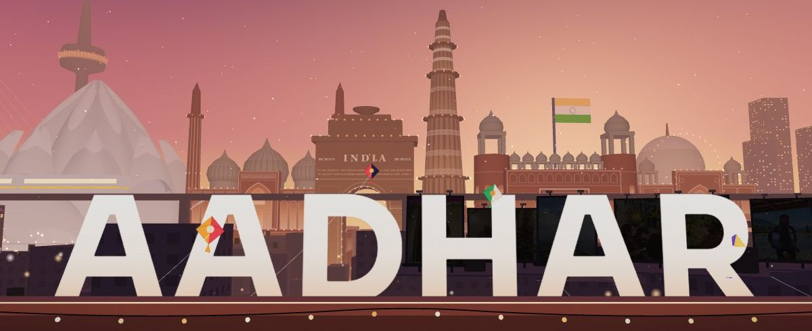

### Designer, developer & founder of [Maanak.ai](https://www.instagram.com/maanak.ai/)

I combine design, engineering and intelligent automation to build digital experiences that help businesses move forward. Based in Delhi, working with clients in four countries.

**30+ websites · 15+ clients · 4 countries**

#### What I build

- **Websites & 3D web experiences**: fast business sites, stores and interactive pages
- **UI/UX & branding**: logos, landing pages, brochures, product design
- **AI agents & automation**: chat assistants, WhatsApp and Instagram flows, n8n workflows

#### Selected work

| | |
|---|---|
| [aadhargrover.com](https://aadhargrover.com) | My own site: an interactive 3D ride through Delhi |
| [VIN Realty Group](https://vinrealtygroup.com.au/) | Real estate agency, New South Wales |
| [Fortivo Health](https://fortivohealth.com/) | Wellness brand and store |
| [GR Hospital](https://grhospitalkosi.com/) | Hospital website |
| [Amitabh Dev](https://www.amitabhdev.com/) · [Bharat Samachar](https://bharatsamachar.com/) | Personal brand and news site |
| [Shiva Trading Co.](https://shivatradingco.com/) | Building materials trade |
| [SIP EdTech](https://sipedtech.com/) · [Success in Pharma](https://successinpharma.com/) | Education platforms |

#### Stack

React · Next.js · TypeScript · Three.js · Tailwind CSS · WordPress · Framer · Figma · n8n · Gemini

#### Reach me

[aadhargrover.com](https://aadhargrover.com) · [LinkedIn](https://www.linkedin.com/in/aadhargrover/) · [Instagram](https://www.instagram.com/a.a.d.h.a.r/) · maanakdigitalsolutions@gmail.com
